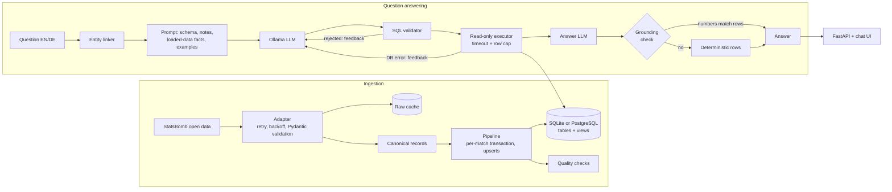

# Offsyde

Ask questions about football matches in plain **English or German** and get answers computed from real event data. A local LLM ([Ollama](https://ollama.com)) writes the SQL; deterministic code validates it, runs it read-only, and refuses to show any number the data doesn't contain.

Illustrative output (the numbers are real; exact wording depends on your model):

```text
> Who scored the most goals?
Victor Boniface scored the most goals with 14.

> Wie viele Tore hat Wirtz erzielt?
Florian Wirtz hat 11 Tore erzielt.

> Which player made the most progressive passes?
Florian Wirtz, with 191.
```

Three seasons from [StatsBomb open data](https://github.com/statsbomb/open-data) are supported out of the box (~400,000 events): Bayer Leverkusen's unbeaten 2023/24 Bundesliga season, and Barcelona's 2018/19 and 2019/20 La Liga seasons (the Messi era). The pipeline is source-agnostic, so other competitions load with one command.

## Why this project is more than a chatbot

Most "chat with your data" demos wire a prompt to a database and hope. This one treats the model as an unreliable component and engineers around it:

| Problem | What Offsyde does |
|---|---|
| Model writes destructive or off-schema SQL | **Three independent layers**: a parser-based validator (single `SELECT`, table whitelist, function blacklist, row cap), a read-only database session, and a query timeout |
| Model misspells names (`Mueller`, `BVB`, `Alex Grimaldo`) | **Entity linking** before the LLM: normalised + fuzzy matching resolves mentions to exact database IDs; ambiguous names are flagged, not guessed |
| Model makes a SQL mistake | **Repair loop**: validation and database errors are fed back to the model (up to 2 retries) |
| Model invents numbers in its answer | **Grounding check**: every number in the answer must be traceable to the result rows; otherwise a deterministic rendering of the rows is shown instead |
| "Is it any good?" | **Execution-accuracy benchmark** with 43 questions (36 English, 7 German) and gold SQL, plus a harness self-test |
| Silent data corruption | **Idempotent ingestion** + data-quality checks (goals rebuilt from events must equal every final score) |

## Architecture



Design rationale is in [docs/design-decisions.md](docs/design-decisions.md).

## Quick start

Requirements: Python 3.11+, [Ollama](https://ollama.com/download).

```bash
git clone <this repo> && cd offsyde
python -m venv .venv && source .venv/bin/activate
pip install -e ".[dev]"

offsyde ingest                                  # Bundesliga 2023/24, Leverkusen (~100 MB, a few minutes)
offsyde ingest --competition 11 --season 4      # La Liga 2018/19, Barcelona
offsyde ingest --competition 11 --season 42     # La Liga 2019/20, Barcelona
ollama pull qwen2.5-coder:7b        # the default model, see "Choosing a model"
offsyde serve                       # http://127.0.0.1:8000
```

On Windows (PowerShell):

```powershell
git clone <this repo>; cd offsyde
python -m venv .venv
.venv\Scripts\Activate.ps1
pip install -e ".[dev]"
offsyde ingest
ollama pull qwen2.5-coder:7b
offsyde serve
```

From the terminal:

```bash
offsyde ask "How many points did Leverkusen collect away from home?"
offsyde ask "Wie viele gelbe Karten hat Xhaka bekommen?" --json
```

With Docker (Ollama included):

```bash
docker compose up -d
docker compose exec ollama ollama pull qwen2.5-coder:7b
docker compose run --rm app offsyde ingest                                # Leverkusen
docker compose run --rm app offsyde ingest --competition 11 --season 4     # Barcelona 2018/19
docker compose run --rm app offsyde ingest --competition 11 --season 42    # Barcelona 2019/20
# open http://localhost:8000
```

### Configuration

| Variable | Default | Purpose |
|---|---|---|
| `OFFSYDE_DB_URL` | `sqlite:///data/offsyde.db` | any SQLAlchemy URL; PostgreSQL: `postgresql+psycopg://user:pw@host/db` (`pip install ".[postgres]"`) |
| `OFFSYDE_MODEL` | `qwen2.5-coder:7b` | Ollama model name |
| `OLLAMA_HOST` | `http://localhost:11434` | Ollama server |
| `OFFSYDE_NUM_CTX` | `8192` | context window; Ollama's default (2048) would silently truncate the schema prompt |
| `OFFSYDE_MAX_ROWS` / `OFFSYDE_QUERY_TIMEOUT` | `200` / `10` s | result cap and query time limit |
| `OFFSYDE_RATE_LIMIT` | `30` | requests per minute per client IP |

Other competitions: `offsyde competitions` lists everything available, then e.g. `offsyde ingest --competition 43 --season 106` (FIFA World Cup 2022). The two benchmarks are written for the datasets above; the prompt adapts to whatever is loaded.

## Data

| Table / view | Contents |
|---|---|
| `matches`, `teams`, `players`, `lineups` | match results, squads, starters |
| `events` | every on-pitch event (passes, shots, carries, pressures, duels, ...) with x/y coordinates |
| `shots` *(view)* | shots with xG, outcome, `is_goal`, `is_on_target`, season |
| `passes` *(view)* | passes with completion, assists, a simplified `is_progressive`, season |
| `team_matches` *(view)* | one row per team per match: goals for/against, result, points |

The views are deliberate: they pre-join and pre-derive the awkward parts so the model has fewer ways to be wrong.

**Coverage caveats.** StatsBomb's free data is not complete, and Offsyde says so rather than hiding it:

| Dataset | Matches loaded | Notes |
|---|---|---|
| Bundesliga 2023/24 | 34 of 34 | only Leverkusen's matches; the other 17 clubs appear only in their two games against it |
| La Liga 2018/19 | 34 of 38 | Barcelona only; match weeks 10, 11, 32, 36 missing |
| La Liga 2019/20 | 33 of 38 | Barcelona only; match weeks 1-4 and 7 missing |

So league-wide questions ("top scorer in La Liga") cannot be answered, and season totals for Barcelona (points, goals, wins) cover the loaded matches only. Both facts are detected from the data at startup, put into the prompt, and the answer model is told not to present a partial total as a full-season figure. A bare "2019" is ambiguous between 2018/19 and 2019/20, and the model is told to treat it that way.

## Evaluation

Two benchmark files hold questions with gold SQL:

| File | Questions | Covers |
|---|---|---|
| `benchmarks/bundesliga_2023_24.json` | 43 (36 EN, 7 DE) | results, scoring, passing, discipline, squad |
| `benchmarks/laliga_barcelona_2018_20.json` | 26 (23 EN, 3 DE) | the same categories on the Barcelona seasons, with season scoping, multi-season sums and El Clásico |

They include German questions, nickname and surname-only mentions, and ratios with specified rounding. Every ranking question was checked for ties so each has a single correct answer, and questions that would otherwise be ambiguous across seasons name the season explicitly.

A prediction is correct if it returns the same data as the gold query (rows and columns in any order, extra columns allowed, numbers rounded to 2 decimals). This is *execution accuracy*: it judges what the query returns, not how it is written.

```bash
offsyde eval --out reports/qwen2.5-coder-7b.json                 # real model, Bundesliga set
offsyde eval --benchmark benchmarks/laliga_barcelona_2018_20.json  # Barcelona set
offsyde eval --model llama3.1:8b --out reports/llama3.1-8b.json  # compare models
offsyde eval --with-answers                                      # also measure answer grounding
offsyde eval --oracle                                            # harness self-test, no LLM needed
```

**Harness self-test.** `--oracle` answers each question with its own gold SQL and must score 100%. It does for both benchmark files on the full three-season SQLite database, and on PostgreSQL for the Bundesliga set, where the gold queries also return identical results to SQLite. Unit tests also confirm that a wrong model scores 0% and an unsafe one scores 0% valid SQL.

**Model results** (fill in after running on your machine; the report JSON has per-question detail):

| Model | Execution accuracy | First-attempt | Valid SQL | p50 latency |
|---|---|---|---|---|
| `qwen2.5-coder:7b` | _run `offsyde eval`_ | | | |
| `llama3.1:8b` | | | | |

## Safety layers

1. **Validator** (`nl2sql/validator.py`) parses the SQL with `sqlglot`. Rejects multiple statements, anything but `SELECT`/`WITH`, tables outside the documented whitelist (including `sqlite_master`, `source_ids`), schema-qualified names, and dangerous functions (`load_extension`, `pg_sleep`, ...). Adds or clamps `LIMIT`.
2. **Read-only session** (`db.py`): SQLite `PRAGMA query_only`, PostgreSQL `default_transaction_read_only`. Holds even if the validator were bypassed. For production, also connect with a database role that only has `SELECT`.
3. **Timeout**: SQLite progress handler / PostgreSQL `statement_timeout` abort runaway queries.
4. **Grounding** (`nl2sql/grounding.py`): numbers in the model's answer are checked against the result rows, the question, and the SQL. Ungrounded answers are replaced by a deterministic rendering of the rows and flagged in the UI.

## Testing

```bash
pytest                                              # 145 tests, SQLite, ~5 s, no network, no LLM
export OFFSYDE_TEST_PG_URL=postgresql+psycopg://user@localhost/offsyde_test
pytest                                              # + 5 PostgreSQL integration tests
ruff check . && ruff format --check .
```

The suite runs offline: the StatsBomb adapter is tested through a mock HTTP transport serving trimmed real match files (`tests/fixtures/`), and the LLM is replaced by scripted stand-ins. Highlights: ingestion idempotency and failure isolation, 20 attack-style SQL strings, schema-documentation drift detection (the prompt's schema description is checked against the real database), and every benchmark gold query validated against the schema. CI (`.github/workflows/ci.yml`) runs lint and the tests on Python 3.11 and 3.13 with a PostgreSQL service container, then builds the Docker image.

## Project layout

```text
src/offsyde/
  ingestion/   adapter -> canonical records -> pipeline -> quality checks
  nl2sql/      schema_doc, entities, prompts, llm (Ollama), validator, executor, grounding, service
  api/         FastAPI app + static chat UI
  evals.py     execution-accuracy harness
  models.py, views.py, db.py, config.py, cli.py
benchmarks/    gold question set
tests/         unit + integration tests, trimmed real fixtures
```

Adding a data source means implementing the three-method `SourceAdapter` protocol in `ingestion/canonical.py`.

## Limitations and next steps

- Model accuracy depends on the model you run; small local models will miss some questions. The benchmark exists to measure that and to compare prompt and model changes.
- The Docker setup and GitHub Actions workflow are written but were not executed in the environment this was built in; the Python package, tests, SQLite and PostgreSQL paths were.
- Entity linking is tuned for German and Spanish club and player names and resolves shared surnames by activity in the data; it is not a general name resolver. A second data source would need cross-source player matching (the `source_ids` table is the hook for it).
- The server builds its entity index at startup, so restart it after loading new data.
- The in-memory rate limiter is per process. Use a shared store for multi-worker deployments.
- Ideas: streaming responses, retrieval over match reports for "why" questions, a fine-tuned small text-to-SQL model evaluated on this benchmark, per-question cost/latency tracking.

## Attribution

Match data: [StatsBomb open data](https://github.com/statsbomb/open-data). Please read and follow their [user agreement](https://github.com/statsbomb/open-data/blob/master/doc/Open%20Data%20License%20Agreement.pdf), including crediting StatsBomb in anything you publish. The files in `tests/fixtures/` are small excerpts of that data.
